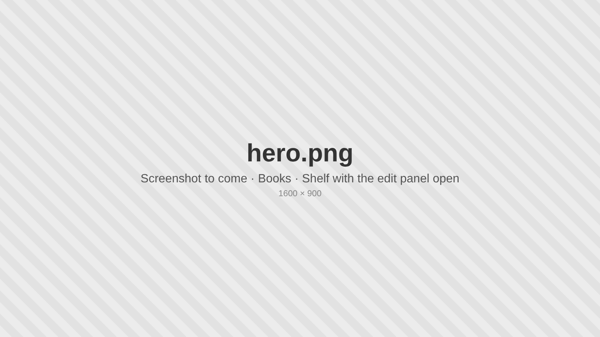
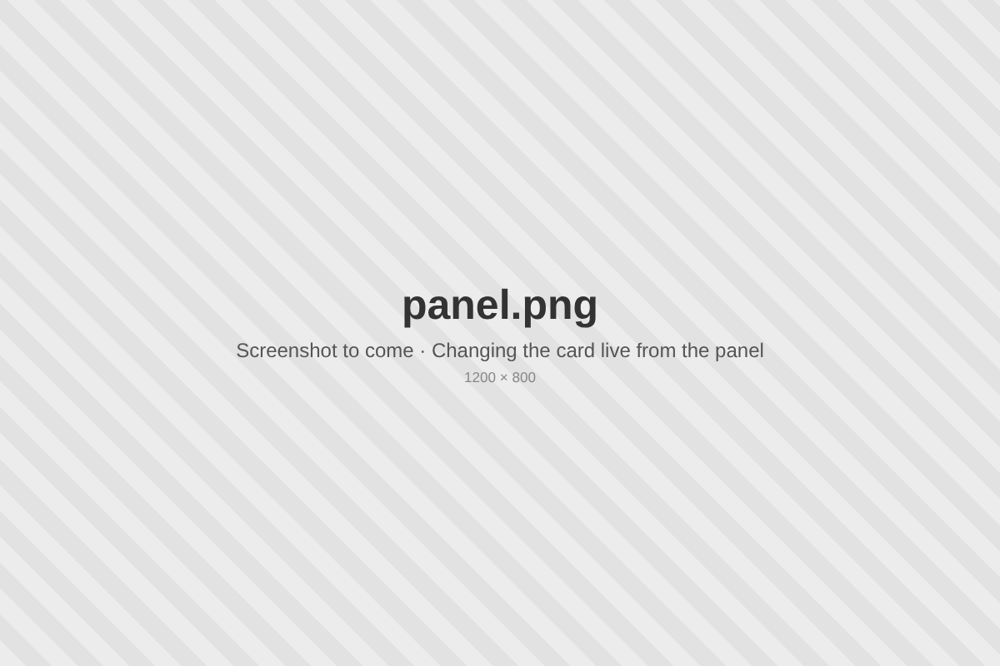
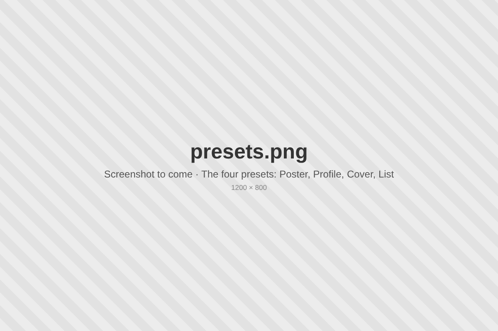
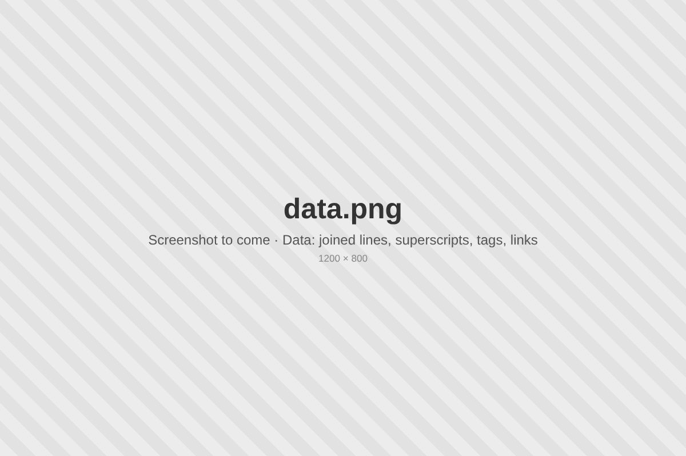
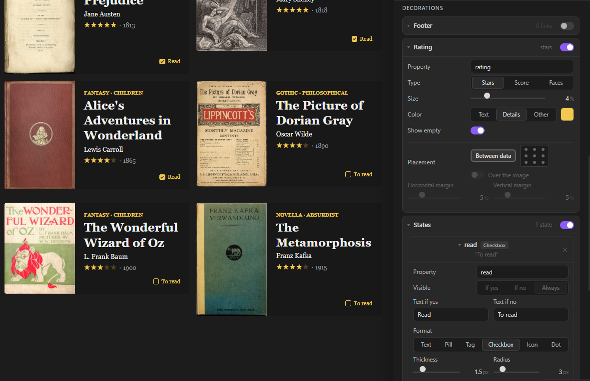
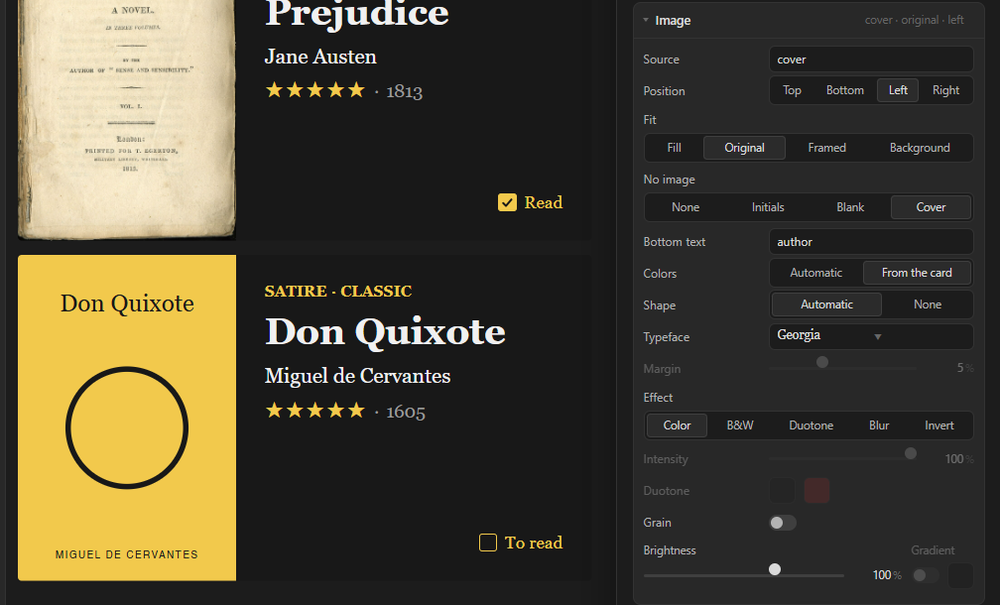
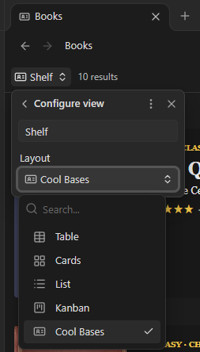

# Cool Bases

Turn your [Bases](https://help.obsidian.md/bases) into cards you design yourself, from a visual side panel.

🇪🇸 [Leer en español](README.es.md)

## What it does

- **A new view type for Bases.** Your notes show up as cards: books, films, people, places, projects… anything with properties.

- **Design the card from a panel, live.** Size, colors, font, image, data and decorations. Every change shows on the cards at once. Nothing is saved until you press **Done**.

  

- **Four presets to start from.** Poster, Profile, Cover and List. Save your own styles, or copy the style of any other Cool Bases view in your vault.

  

- **Your data, your way.** Drag the properties into order, put two on the same line, turn one into a superscript, show lists as tags, links as site names, linked notes one per line.

  

- **Ratings and states.** Stars, scores or faces from a number or from ⭐ emoji. Yes/no properties as text, pills, tags, icons, dots… or a checkbox you can tick right on the card.

  

- **Covers for notes without an image.** A simple typographic cover is drawn for them, so every card keeps the same size.

  

## Install

**From Community plugins** (once it's listed): Settings → Community plugins → Browse → search for **Cool Bases** → Install → Enable.

**With BRAT:** install the [BRAT](https://github.com/TfTHacker/obsidian42-brat) plugin, choose **Add beta plugin** and paste `pattgue/cool-bases`.

**By hand:** download `main.js`, `manifest.json` and `styles.css` from the [latest release](https://github.com/pattgue/cool-bases/releases/latest) and put them in `.obsidian/plugins/cool-bases/` inside your vault. Restart Obsidian and enable **Cool Bases** in Settings → Community plugins.

## Quick start

1. Turn on the **Bases** core plugin (Settings → Core plugins → Bases).
2. Create a base: right-click a folder → **New base**, or use the command **Bases: Create new base**.
3. In the views menu at the top left of the base, add a view (or edit the current one) and choose **Cool Bases** as its layout.

   
4. Press **✎ Edit card** (top right of the view). The panel opens on the right.
5. Change whatever you like and press **Done**.

The cards start with the properties you ticked in the base's **Properties** menu. Click a card to open its note.

Want to try it with real data first? The [`demo-vault`](demo-vault) folder has a small vault with books and films, already designed.

## The edit panel

The panel edits the whole view: all its cards at once. Each view of each base keeps its own design, saved inside the `.base` file.

At the top: **Undo** (or Ctrl/Cmd+Z), **Cancel** (or Escape: leaves the view as it was) and **Done** (saves).

### Styles
- **Presets**: Poster, Profile, Cover and List, plus **My styles**.
- **Save style**: keeps the current design under a name, for any view in this vault.
- **Copy from another view**: takes the design of another Cool Bases view (not its data).

### Card
- **Size**: width, height or a fixed format (1:1, 4:5, 3:4, 2:3, 16:9), fill width, padding, corner radius and gap between cards.
- **Colors**: background (with an optional gradient), text, details (the accent color) and border.
- **Font**: typeface, weight, size and alignment. You can pick any font installed on your computer, or type its name.
- **Image**: which property holds the image, its position and fit (**Fill**, **Original**, **Framed**, **Background**), effects (B&W, duotone, blur, invert), grain, brightness and a dark gradient. **No image** decides what notes without an image show: nothing, their initials, a blank space or a generated **Cover**.

### Data
- The **title** comes first and carries a lock 🔒: tap it to move the title like any other item (data can also go above it). In **Show** you choose what it displays: the note name, the first alias, another property, or nothing at all (handy when the cover already shows the title).
- Drag the other properties into order, remove them with ✕ and add more with **+ Add data**.
- The chain icon between two items puts them on the **same line**, with a separator. If the first one is empty in a note, the second one starts its own line.
- **Placement**: each item (the title too, once unlocked) goes between the data or in any of the 9 spots of the card, also over the image. Items in the same spot stack, or share a line if they're joined.
- Each item has its own typeface, uppercase, color, size, weight, **Fit** (one line, shrinks to fit), space above and below, italic, underline, highlight, strikethrough, superscript, link and hover.
- Types: **Text**, **Number**, **Smart number** (a follower or listener count that links to the profile), **Tags**, **Link** and **Linked notes** (including the notes that link *to* this one).

### Decorations
- **Footer**: a strip at the bottom of the card for links (website, social profiles…).
- **Rating**: stars, a score (like 8⁄10) or faces, between the data or in any of the 9 spots of the card.
- **States**: one for each yes/no property you want to show: text, pill, tag, checkbox, icon or dot.
- **Lines**: dividers you drag between the data.
- **Hover**: how links look under the pointer.

### Custom CSS
For anything else. It only applies to this view. Useful classes: `.cb-card`, `.cb-body`, `.cb-media`, `.cb-l` (a line of data), `.cb-i[data-prop="note.year"]` (one item), `.cb-st` (a state), `.cb-foot`.

## Tips

- **Ratings with emoji.** If your ratings look like `⭐⭐⭐⭐`, Cool Bases counts the stars. Numbers work too (choose what they're out of).
- **Tick from the card.** Give a yes/no property (like `read`) a state with the **Checkbox** format: click it on the card to change the note, without opening it.
- **Generated covers.** Image → No image → **Cover**. Choose the text at the bottom (the author, the director, the year…), automatic or card colors, and a shape.
- **Several data on one line.** Click the chain between two items: `1927 · Germany · 153 min`. Ratings and states can join a line too.
- **Superscripts.** Turn on **Superscript** in an item to place it small and high after the one before, like a year next to a title.

## FAQ

**Where is my design saved?**
In the `.base` file, inside the view, under the `coolbases` key. Delete that key to go back to the default card.

**Does it change my notes?**
Only if you tick a **Checkbox** state on a card: that changes the yes/no property of that note. Nothing else is written to your notes.

**What does it read?**
The properties of your notes, through Obsidian, to draw the cards. And only for **Copy from another view** it lists the `.base` files in your vault, to find their Cool Bases views. It reads nothing else and sends nothing to the internet.

**Can I use my own fonts?**
Yes: any font installed on your computer. If Obsidian can't list them, type the font's name in the typeface search. Generated covers can only use fonts installed on the system.

**Does the smart number update itself?**
No. It shows the number stored in the note and links to the profile. Keeping the number up to date is up to you (or another plugin).

**Does it connect to the internet?**
No. It only shows the images your notes point to.

## Compatibility

- Obsidian **1.10** or later (it needs the Bases view API).
- Desktop and mobile.

## Support and feedback

Found a bug or have an idea? Open an [issue on GitHub](https://github.com/pattgue/cool-bases/issues). Screenshots help a lot.

## License

[MIT](LICENSE) © 2026 Patt
